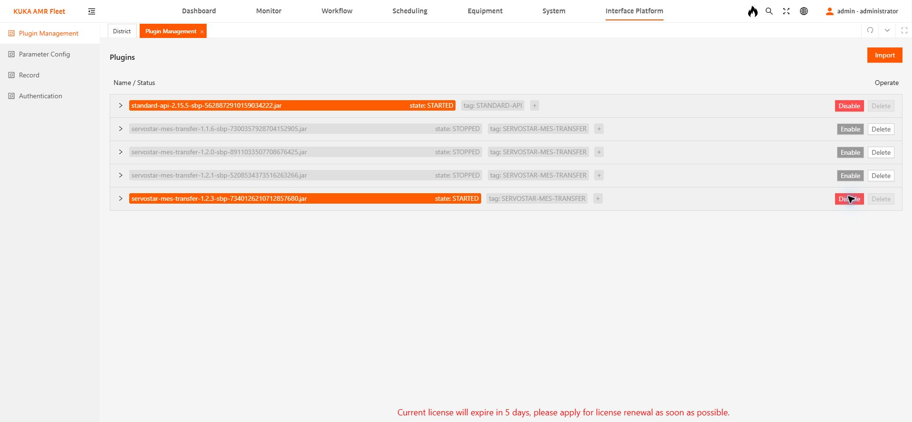

# 알람 발생·유지·해제 실제 가상 Fleet 시험 결과

2026-10-30, Windows/KST 기준. 플러그인 **1.2.3 서버 적용 완료**, 기존 Virtual MCS 배포본 **2.2.0**, 기존 KMP1500I SIM01 AMR 1/2/3 유지. 실제 하드웨어 AMR 시험은 아니다.

## 결과: 이번 작업 경고 시험 통과

| 시험 | Fleet 작업 / AMR | S5F1 발생 | S5F1 해제 | 차량 702/701 | ACK | 운송 완료 |
|---|---|---|---|---|---|---|
| 출발 포트90 차단, 배차 전 경고 | 6901 / 발생 시 차량 미할당 | 14:25:37.080, 1회 | 14:26:08.603, 1회 | 없음, 미할당 차량 번호를 만들지 않음 | S5F2 각각0 | 207/Result0 1회, ACK0 |
| AMR 배차 후 목적 포트90 차단 | 6902 / AMR2 | 14:27:33.982, 1회 | 14:27:53.555, 1회 | 702와701 각각1회 | S5F2·S6F12 모두0 | 207/Result0 1회, ACK0 |

두 경우 모두 Fleet `warnCode=200103`을 실제로 유도했다. S5F1은 같은 시험 ALID **1200103**, 발생 ALCD134(0x86), 해제 ALCD6(0x06)이다. 첫 시험의 보고 간 약31.5초, 두 번째 약19.6초 동안 발생 보고가 추가되지 않았다. 각 시험의 TRANSFER는 한 번만 전송했다.

- 작업6901 COMMANDID: `C3E5B29C7CD441E2A51835BA93038D95`, PORT90 → PORT97.
- 작업6902 COMMANDID: `E4AD2CC08E3A42D4BD941F8F447F433A`, PORT97 → PORT90.
- 두 시험 모두 기존 영역 `CODEX_ALARM_TEST_261030`만 일시 활성화하고 해제했다.
- 최종: `version=1.2.3`, `communicating=true`, `healthy=true`, `TSC=AUTO`, 활성 알람0, 미확인 보고0, 미완료 Native 작업0.
- AMR1/2/3 모두 빈 차·Idle·리프트 하강·미션 없음. SIM_CARGO_001은 원래 PORT90에 비적재 상태로 돌아왔다. 다른 두 화물은 유지했다. 시험 영역은 비활성 상태로 보존했다.

## 원인과 변경

구버전1.2.2 시험 작업6899/6900의 경고는 jobQuery에는 표시됐지만 `WARNING/WARN_CLEAR` 구독 콜백에는 없었다. 1.2.3은 Native SECS 소유 작업의 경고를 정확한 jobQuery로 추가 감시한다. 발생·해제 상태와 보고를 저널에 보존하고, 조회 실패나 누락을 해제로 처리하지 않는다. 같은 ALID의 동시 경고와 콜백/조회 중복 수집도 집계한다.

ALID1200103은 프로젝트 시험 프로필 값이며 공식 SKI/KUKA 할당값이나 오류 설명이 아니다. 전체 하드웨어 알람, 비상정지·통신 단절을 포함한 차량 전용 알람 수집, 조회 사이에 발생·해제되는 짧은 경고까지 검증한 것은 아니다. 적용 범위는 [1.2.3 적용방법](WORKFLOW_ALARM_1.2.3_적용방법.md)을 따른다.

## 보존한 근거

- [송수신 자동 집계](../../tmp/alarm_test_20261030/live_1.2.3_summary.json): SystemBytes로 S5F2와 701/702/207 ACK를 연결해 확인.
- [작업6901 메시지 원문](../../tmp/alarm_test_20261030/live_1.2.3_workflow_6901_messages.log).
- [작업6902 메시지 원문](../../tmp/alarm_test_20261030/live_1.2.3_workflow_6902_messages.log).
- [최종 API 조회 상태](../../tmp/alarm_test_20261030/final_1.2.3_live_state.json).
- [로컬·배포 검증 메타데이터](../fleet_transfer_plugin/build/validation_1.2.3.json): 로컬2050건, 신규 알람57건, 패키지 API 등록·해제 검증, 실서버 JAR 해시 일치.

플러그인 교체 후 Visual Studio 디버그 MCS가 자동 S1F13의 포착된 예외에서 중단됐다. 디버그 실행을 종료하고 기존 배포용2.2.0을 실행해 같은 저장 프로필·작업 이력을 보존한 채 재연결했다. PC 소스나 실행 파일은 이번 수정에서 교체하지 않았다. 서버 저널·화물 이력은 편집하지 않았다.

