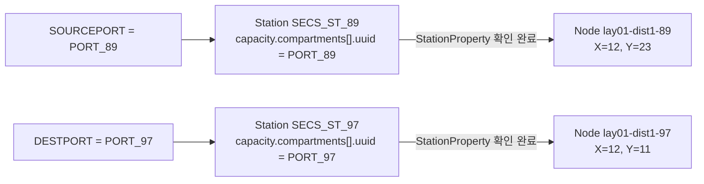

# SECS From/To와 Fleet API 필드 매핑

이 문서는 설치본의 API 정의와 실제 조회 결과를 대조하기 위한 안내다. **2026-10-26 추가 확인으로 Station·Port 등록과 지도 연결까지 완료됐다.** 지도 연결은 사용자가 노드 External Code에 Station UUID를 입력하고 저장한 뒤 GraphData로 검증했다. 기존 KMP1500i New Sims의 native Order Engine 연계는 미완료다. 최신 근거는 [추가 확인 결과](/C:/work/KUKA/SECS/native_transfer/manual_api/20261026_추가확인결과.md)를 먼저 본다. 아래 API 구조·미적용 요청 예제는 조사 당시의 기록이며, 지도 연결 요청을 다시 전송할 필요가 없다.

## 1. API 문서부터 열기

| 문서 | 위치 | 이번 작업과의 관계 |
|---|---|---|
| Interface Platform Swagger | [서버 API 문서](http://192.168.0.45:10870/interfaces/doc.html?lang=en) | HTTP REST 문서. 현재 조회에서는 Plugin Operation, Token Controller의 15개 경로만 표시된다. Station/Graph gRPC 정의가 표시되는 문서는 아니다. |
| Station 등록 API | [manage_station_data_command.proto](/C:/work/KUKA/tmp/native_secs_inspect/protos/apis/kuka/mobilerobotics/station/v1alpha1/manage_station_data_command.proto) | INSERT/UPDATE/DELETE 명령과 Station 본문 |
| Station 데이터 | [station.proto](/C:/work/KUKA/tmp/native_secs_inspect/protos/apis/kuka/mobilerobotics/station/v1alpha1/station.proto), [station_capacity.proto](/C:/work/KUKA/tmp/native_secs_inspect/protos/apis/kuka/mobilerobotics/station/v1alpha1/station_capacity.proto), [station_compartment.proto](/C:/work/KUKA/tmp/native_secs_inspect/protos/apis/kuka/mobilerobotics/station/v1alpha1/station_compartment.proto) | Station UUID, capacity, 하위 Port(compartment) |
| 지도 노드와 Station의 연결 | [station_property.proto](/C:/work/KUKA/tmp/native_secs_inspect/protos/apis/kuka/mobilerobotics/graph/v1alpha1/station_property.proto) | 핵심 필드 `station_uuid` |
| 지도 노드 구조 | [topology_node.proto](/C:/work/KUKA/tmp/native_secs_inspect/protos/apis/kuka/mobilerobotics/graph/v1alpha1/topology_node.proto), [graph_property.proto](/C:/work/KUKA/tmp/native_secs_inspect/protos/apis/kuka/mobilerobotics/graph/v1alpha1/graph_property.proto) | 노드 `properties`의 Any에 StationProperty를 넣는 구조 |
| 지도 수정 RPC | [graph_editor_service.proto](/C:/work/KUKA/tmp/native_secs_inspect/protos/apis/kuka/mobilerobotics/graph/v1alpha1/graph_editor_service.proto) | 정의상 `UpsertNodes`. 현재 basic-data endpoint에서는 앞선 빈 노드 요청에 UNIMPLEMENTED가 반환됐다. |
| 내부 운송 주문 | [transfer_order.proto](/C:/work/KUKA/tmp/native_secs_inspect/protos/apis/kuka/mobilerobotics/order/v1alpha1/transfer_order.proto), [station_specification.proto](/C:/work/KUKA/tmp/native_secs_inspect/protos/apis/kuka/mobilerobotics/order/v1alpha1/station_specification.proto) | 운송할 Payload와 도착 Station·compartment 지정 |

`.proto`는 gRPC의 메시지 타입·필드·RPC를 정의하는 원문이다. 설치본에 정의 파일이 있는 것과, 특정 서버 endpoint에 해당 RPC가 구현되어 있는 것은 별도로 확인한다.

## 2. 현재 데이터와 연결하려는 값

| 역할 | SECS 필드 | Port / compartment UUID | Station UUID | Graph UUID | Node UUID | 현재 상태 |
|---|---|---|---|---|---|---|
| 89 → 97 출발 | `SOURCEPORT` | `PORT_89` | `SECS_ST_89` | `lay01-dist1` | `lay01-dist1-89` | Port→Station・Station→Node 모두 확인 완료 |
| 89 → 97 도착 | `DESTPORT` | `PORT_97` | `SECS_ST_97` | `lay01-dist1` | `lay01-dist1-97` | Port→Station・Station→Node 모두 확인 완료 |

97 → 89 운송에서는 SOURCEPORT와 DESTPORT만 서로 바꾼다. Station·Port를 다시 등록할 필요는 없다. SECS COMMANDID는 새 주문을 구분할 수 있도록 별도로 정한다.



실제 데이터에서는 Station이 node_uuid를 보유하는 것이 아니라, **Node의 StationProperty가 Station UUID를 참조한다.** 이 설치본에서는 Node의 External Code가 그 Station UUID로 변환된다.

## 3. 등록한 JSON을 API 정의와 대조

파일: [insert_station_89.json](/C:/work/KUKA/SECS/native_transfer/manual_api/insert_station_89.json)

| JSON 경로 | API 타입/필드 | 뜻 | 현재 값 |
|---|---|---|---|
| `action.uuid` | `ActionDescription.uuid` | 이번 설정 요청의 식별자 | 파일에 생성된 UUID. Station UUID 또는 SECS COMMANDID가 아니다. |
| `action.timestamp` | `ActionDescription.timestamp` | 요청 시각 | UTC 문자열 |
| `action.command.@type` | `google.protobuf.Any` 타입 | 명령 본문 타입 선택 | `type.googleapis.com/kuka.mobilerobotics.station.v1alpha1.ManageStationDataCommand` |
| `action.command.type` | `ManageStationDataCommand.type` | 관리 작업 종류 | `INSERT` |
| `action.command.data.uuid` | `Station.uuid` | 작업장을 구분하는 식별자 | `SECS_ST_89` |
| `action.command.data.name` | `Station.name` | 표시 이름 | `SECS test port at node 89` |
| `action.command.data.capacity.compartments[0].uuid` | `StationCompartment.uuid` | 화물 하나를 놓을 수 있는 공간의 식별자 | `PORT_89` |

`name`에 89를 쓰는 것은 표시용이다. 여기에는 노드 연결 기능이 없다.

호출한 RPC:

```text
192.168.0.45:50110
kuka.actionexecutor.v1alpha1.ActionExecutorService/SubmitAction
```

재조회한 RPC:

```text
192.168.0.45:50110
kuka.dataprovider.v1alpha1.DataProviderService/GetData
data_type = kuka.mobilerobotics.station.v1alpha1.StationData
```

등록 결과 원본: [station_data_registered.json](/C:/work/KUKA/SECS/native_transfer/manual_api/station_data_registered.json)

## 4. 지도에 추가해야 할 필드

문서상 연결 구조:

```text
GraphData
  topology_graphs[]                    uuid = lay01-dist1
    nodes[]                            uuid = lay01-dist1-89
      properties[]                     GraphProperty
        property                       google.protobuf.Any
          @type                        ...apis.kuka...StationProperty
          station_uuid                 SECS_ST_89
```

Protobuf 원문에서는 `station_uuid`, JSON에서는 `stationUuid`로 표현할 수 있다. 아래는 JSON 표기다.

```json
{
  "property": {
    "@type": "type.googleapis.com/apis.kuka.mobilerobotics.graph.v1alpha1.StationProperty",
    "stationUuid": "SECS_ST_89"
  }
}
```

이것은 **노드 properties 배열에 추가할 한 항목**이다. 전체 노드를 대체하는 요청 본문은 아니다. StationProperty의 package 앞 `apis.`는 이 설치본의 정의에 실제로 포함되어 있으므로 임의로 제거하지 않는다.

| 필드 | 89번 | 97번 |
|---|---|---|
| UpsertNodesRequest.graph_uuid | `lay01-dist1` | `lay01-dist1` |
| TopologyNode.uuid | `lay01-dist1-89` | `lay01-dist1-97` |
| TopologyNode.graph_uuid | `lay01-dist1` | `lay01-dist1` |
| TopologyNode.name | `89` | `97` |
| TopologyNode.position.x / y | `12 / 23` | `12 / 11` |
| StationProperty.station_uuid | `SECS_ST_89` | `SECS_ST_97` |

현재 export에서 숫자 89/97은 노드 name/UUID로 확인했다. `TopologyNode.id`는 기본값 0이므로, GUI의 숫자를 보고 id에 89/97을 새로 넣지 않는다.

전체 연결 요청 예제: [map_station_links.reference.json](/C:/work/KUKA/SECS/native_transfer/manual_api/map_station_links.reference.json)

이 예제는 실제 조회한 두 노드를 복사하고 각각 StationProperty만 추가했다. 기존 MotionRecoveryProperty, MotionVelocityProperty, VirtualLineMotionProperty 세 항목과 위치·식별자를 보존했다. JSON↔Protobuf 왕복 파싱도 검증했다. **문서 검토용이며 서버에 전송하지 않았다.** 기존 요청을 다른 지도에 적용하거나 현재 노드가 변경된 뒤 재사용하지 않는다.

정의상 대상 RPC는 다음과 같지만, 이 서버에서는 사용할 수 있는 저장 경로로 검증되지 않았다.

```text
kuka.mobilerobotics.graph.v1alpha1.GraphEditorService/UpsertNodes
```

현재 Order Engine의 GraphData 공급자는 Docker 내부 `krcs-basic-data:7999`다. 여기서 GraphData 조회는 동작하지만, 앞선 `UpsertNodes` 호출은 `UNIMPLEMENTED / Method not found`였다. 이후 배포 이미지 MapGraphMapper 코드와 실제 조회 결과를 통해 **GUI의 노드 External Code에 Station UUID를 넣는 저장 경로가 확인됐다.**

## 5. SECS 주문과 내부 운송 데이터 관계

| SECS 입력 | 내부에서 필요한 데이터 | 이번 예 |
|---|---|---|
| `CARRIERID` | 운반할 Payload 식별 | `SIM_CARGO_001` |
| `SOURCEPORT` | 출발 Station의 compartment 식별. 출발지에서 화물의 위치를 알아야 한다. | `PORT_89` → `SECS_ST_89` |
| `DESTPORT` | 도착 Station의 compartment 식별 | `PORT_97` → `SECS_ST_97` |
| `COMMANDID` | SECS 운송 주문의 식별 | `TR_TEST_001` |

위 Port 해석은 현재 기본 설정(별도 stationCompartmentDelimiter 없음)을 기준으로 한다. 다른 Station에 같은 Port 이름이 생겨 해석이 모호해지지 않도록 유지한다.

`TransferOrder`의 주요 필드는 `payload`, `target`, 선택적인 `robot`이다. From/To 문자열 두 개를 그대로 저장하는 메시지 구조는 아니다. 출발지는 화물 위치 또는 위치 지정으로 표현하고, 도착지는 `StationSpecification`으로 표현한다.

문서상 도착지 표현 예:

```json
{
  "stationUuid": "SECS_ST_97",
  "compartmentUuid": "PORT_97"
}
```

이 예는 `StationSpecification` 부분만 보여준다. 실제 주문 전송 요청은 아니며, SECS 서비스의 명령 변환 로직과 구분한다.

Payload 타입과 위치 정의는 [payload.proto](/C:/work/KUKA/tmp/native_secs_inspect/protos/apis/kuka/mobilerobotics/payload/v1alpha1/payload.proto), 주문에서 Payload를 식별하는 방법은 [payload_specification.proto](/C:/work/KUKA/tmp/native_secs_inspect/protos/apis/kuka/mobilerobotics/order/v1alpha1/payload_specification.proto)를 읽는다.

RCS 웹의 Container 목록에 `SIM_CARGO_001`이 있다는 것만으로 native PayloadData에도 동일 화물이 있다고 판단하지 않는다. 마찬가지로 웹 Robot List에 로봇이 있는 것과 native RobotData에서 사용 가능한 것은 별도 확인한다.

## 6. 문서 검토 순서와 현재 완료 기준

1. `Station.uuid`와 `StationCompartment.uuid`를 등록 결과 JSON과 대조한다. **완료.**
2. `StationProperty.station_uuid`를 읽고 두 노드와 연결할 값을 대조한다. **사용자가 GUI로 저장했고 GraphData로 확인 완료.**
3. 현재 RCS 그래프에서 이 StationProperty를 저장하는 경로를 확인한다. **External Code → MapGraphMapper → StationProperty 경로 확인 완료.**
4. 기존 KMP1500i New Sims를 native RobotData·TransportCapacity·BatteryState와 Pick/Drop 실행에 연결하는 설정을 확인한다. **미확인.**
5. 지도·로봇·Payload 준비가 끝난 뒤 S2F49 수락, 실제 Pick/Move/Drop, 완료 이벤트를 차례로 검증한다. **미실행.**

최초 확인 근거: [registration_verification.json](/C:/work/KUKA/SECS/native_transfer/manual_api/registration_verification.json). 지도 연결 후 확인 근거: [graph_station_links_verified.json](/C:/work/KUKA/SECS/native_transfer/manual_api/graph_station_links_verified.json). 최초 조회의 RobotData에는 서버 UUID만 있었으며, 지도 연결 이후에도 기존 가상 로봇이 native 경로로 연계됐다는 증거는 없다.

## 7. 정의를 명령으로 직접 보기

Windows PowerShell:

```powershell
cd C:\work\KUKA\SECS\native_transfer\manual_api
.\grpcurl.exe -protoset .\station_api.pb describe kuka.mobilerobotics.station.v1alpha1.Station
.\grpcurl.exe -protoset .\station_api.pb describe kuka.mobilerobotics.station.v1alpha1.StationCompartment
.\grpcurl.exe -protoset .\mapping_reference_api.pb describe apis.kuka.mobilerobotics.graph.v1alpha1.StationProperty
.\grpcurl.exe -protoset .\mapping_reference_api.pb describe kuka.mobilerobotics.graph.v1alpha1.UpsertNodesRequest
```

이 `describe` 명령들은 로컬 API 정의를 표시하며 서버에 등록/운송 요청을 보내지 않는다.
